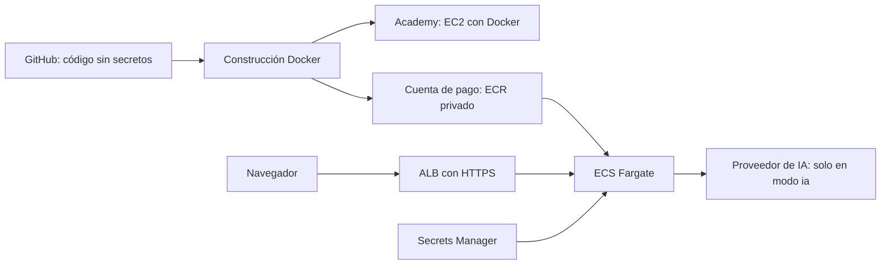

# FitAdapt AI: GitHub seguro, Docker y despliegue en AWS

Fecha de preparación: 15 de octubre de 2026. Los comandos PowerShell se ejecutan en Windows; los bloques Bash, dentro de la instancia Linux. Sustituye los valores `TU_...` antes de ejecutarlos. Las pantallas y permisos disponibles pueden variar según la cuenta y el laboratorio.

## 1. Punto de partida y orden del trabajo

La aplicación utiliza Vue 3, TypeScript y Vite en el cliente, y FastAPI en Python para `/api/health` y `/api/generate-routine`. No necesita base de datos para su funcionamiento actual. La clave del proveedor de IA solo se utiliza en el servidor. El despliegue existente de Vercel es independiente de los nuevos recursos AWS.

La carpeta que se utilizará como raíz del repositorio es **FitAdaptAI**, que contiene código, pruebas y documentación. La carpeta vecina `fitadaptai-deploy` es una copia para despliegue y no debe mezclarse con el repositorio principal.

Orden recomendado:

1. Revisar secretos y publicar el código en un repositorio privado de GitHub.
2. Construir y verificar la imagen Docker en modo demo.
3. Desplegar esa imagen en EC2 dentro de AWS Academy.
4. Publicar la imagen en ECR de la cuenta de pago y desplegarla con ECS Fargate.
5. Añadir HTTPS, comprobar el resultado y registrar evidencias.
6. Eliminar los recursos de práctica y revisar la facturación.

### Decisiones confirmadas por el responsable

- Cuenta GitHub: `franmatias`. Nombre propuesto para el nuevo repositorio: `fitadaptai`, inicialmente privado; comprobar disponibilidad antes de crearlo.
- Se continuará primero con GitHub y AWS Academy. La ejecución en la cuenta AWS de pago queda aplazada; sus instrucciones se conservan para la fase posterior.
- El acceso a Academy se realizará con la cuenta educativa indicada por el responsable. El correo de acceso no se incluye en los archivos que se publicarán en GitHub.
- La región y los servicios de Academy se concretarán tras comprobar las restricciones del Learner Lab activo.

### Arquitecturas propuestas



| Componente | Para qué se utiliza | Configuración de esta guía |
| --- | --- | --- |
| GitHub | Versionado y revisión del código | Repositorio privado inicialmente; sin `.env` |
| Docker | Empaquetar cliente y API | Una imagen Linux x86_64; puerto interno 8000 |
| EC2 | Máquina virtual administrada por nosotros | Academy: Amazon Linux 2023, Docker y una instancia |
| EBS | Disco de la máquina EC2 | Volumen cifrado; verificar borrado al terminar |
| ECR | Almacén privado de imágenes | Cuenta y región independientes para cada entorno |
| ECS Fargate | Ejecutar contenedores sin administrar máquinas | Una tarea inicial; ampliar a dos para disponibilidad |
| VPC y subredes | Red de los recursos | Dos subredes públicas en zonas distintas para ALB |
| Security Groups | Reglas de entrada/salida | ALB recibe HTTPS; contenedor recibe 8000 solo desde ALB |
| IAM | Permisos de usuarios y servicios | Roles separados; sin claves permanentes en la app |
| Secrets Manager | Guardar la clave de IA | Opcional en demo; inyección al arrancar la tarea |
| CloudWatch Logs | Consultar errores y actividad | Retención inicial de siete días |
| ACM y DNS | Certificado y nombre HTTPS | Certificado en la misma región que ALB |
| AWS Budgets | Avisos de gasto | Alertas; no constituye un límite automático de gasto |

La elección EC2 para Academy y Fargate para la cuenta de pago es una propuesta para este proyecto. EC2 también es una alternativa válida en la cuenta de pago si se prioriza reducir componentes y se acepta administrar el servidor.

## 2. Herramientas del equipo Windows

### 2.1. Comprobar instalaciones

Desde PowerShell, en la carpeta FitAdaptAI:

```powershell
git --version
node --version
npm.cmd --version
.\.venv\Scripts\python.exe --version
docker version
docker compose version
aws --version
ssh -V
```

Se utiliza Node 22 y Python 3.12 dentro de Docker. Tener otras versiones locales no modifica las versiones de la imagen. `docker version` debe mostrar **Client y Server**; tener únicamente el cliente no permite construir ni ejecutar imágenes.

### 2.2. Docker Desktop y WSL 2

1. Si Docker Desktop ya está instalado, abrirlo y esperar a que el motor esté preparado.
2. En Settings, comprobar que utiliza el motor WSL 2 y contenedores Linux.
3. Si falta Docker, instalarlo desde su [página oficial](https://docs.docker.com/desktop/setup/install/windows-install/).
4. Si el instalador solicita WSL, abrir PowerShell como administrador, ejecutar `wsl --install` y reiniciar cuando Windows lo solicite. Comprobar después `wsl --status` y `wsl --update`.
5. Si aparece un problema de virtualización, comprobar que está habilitada en BIOS/UEFI y que Windows tiene disponibles las características necesarias para WSL 2.
6. Repetir `docker version` y `docker run --rm hello-world`.

No reinstalar Docker antes de comprobar si simplemente estaba detenido. Un error de permisos al consultar el motor desde un entorno restringido no demuestra que WSL esté averiado.

### 2.3. AWS CLI v2

La CLI permite autenticar perfiles, consultar AWS y publicar imágenes en ECR. Seguir la [instalación oficial para Windows](https://docs.aws.amazon.com/cli/latest/userguide/getting-started-install.html). El instalador para el usuario actual evita una instalación global cuando no es necesaria.

1. Descargar el MSI oficial enlazado en la documentación.
2. Comprobar en Propiedades → Firmas digitales que el editor es Amazon Web Services y la firma es válida.
3. Instalar, cerrar PowerShell y abrirlo de nuevo para actualizar PATH.
4. Ejecutar `aws --version`; debe indicar `aws-cli/2`.

Si se ha instalado para este usuario y aún no se actualizó PATH:

```powershell
& "$env:LOCALAPPDATA\Programs\Amazon\AWSCLIV2\aws.exe" --version
```

GitHub CLI es opcional: Git y el navegador bastan para publicar el repositorio. No se necesitan Kubernetes, una base de datos ni un servidor Node en EC2: la imagen ya contiene el cliente compilado y el servidor Python.

## 3. GitHub: publicación segura paso a paso

### 3.1. Proteger archivos antes del primer commit

1. Trabajar dentro de `FitAdaptAI`, sin incluir las carpetas vecinas.
2. Conservar `.env` como configuración privada local. No copiar su contenido a la documentación, al chat ni a GitHub.
3. Conservar `.env.example` como plantilla sin valores privados.
4. Revisar `.gitignore`: excluye `.env`, `.env.*` excepto `.env.example`, claves privadas, `.aws`, `.ssh`, dependencias e informes.
5. No introducir claves en variables `VITE_*`: esas variables se incorporan al JavaScript público del navegador.
6. No guardar credenciales en Dockerfile, `compose.yaml`, workflows, capturas, URL del remoto ni archivos de ejemplo.

La exclusión de Git y la exclusión de Docker son protecciones distintas; se necesitan ambas. `.gitignore` no elimina archivos que ya estén versionados.

### 3.2. Inicializar y comprobar exclusiones

Esta copia no tenía repositorio Git al empezar la preparación. Primero comprobarlo; si ya existe uno, conservarlo:

```powershell
git rev-parse --show-toplevel
# Solo si el comando anterior indica que NO existe un repositorio:
git init -b main

git check-ignore -v .env .env.local .env.docker .aws/credentials prueba.pem
git status --short --untracked-files=normal
```

`check-ignore` debe identificar las reglas de exclusión para esos archivos. Comprobar también que `.env.example` sí puede añadirse. Configurar nombre y correo local si Git los solicita:

```powershell
git config user.name "TU_NOMBRE"
git config user.email "TU_CORREO_O_NOREPLY_DE_GITHUB"
```

### 3.3. Preparar y revisar el commit

```powershell
git add .
git diff --cached --name-only
git ls-files --cached -- '.env' '.env.*' '*.pem' '*.key' '.aws/*' '.ssh/*'
git diff --cached --stat
```

En la búsqueda de archivos sensibles solo debe aparecer `.env.example`, si corresponde. Si aparecen `.env`, credenciales o claves privadas, detener la publicación. Retirar cada ruta concreta del índice con `git rm --cached -- RUTA` y corregir las exclusiones; esto conserva el archivo local. Si hay secretos en commits anteriores, retirarlos del índice no basta: revocar o rotar primero las claves y seguir el procedimiento de limpieza del historial de GitHub.

Revisar los cambios preparados de forma local y buscar también secretos incrustados en código o documentación, no solo nombres de archivos. Para señalar posibles archivos sin imprimir sus valores:

```powershell
git grep --cached -I -l -E '(AKIA|ASIA)[A-Z0-9]{16}|sk-[A-Za-z0-9_-]{24,}|BEGIN (RSA |OPENSSH |EC )?PRIVATE KEY'
```

Una coincidencia requiere revisión; la ausencia de coincidencias no certifica que no existan secretos. Si hay historial, utilizar además un analizador de secretos sobre todos los commits antes de publicar. No forzar el push ante una alerta sin resolverla.

```powershell
git commit -m "Prepare FitAdapt AI for GitHub and Docker deployment"
```

### 3.4. Crear y publicar el repositorio

1. Iniciar sesión en GitHub y activar MFA.
2. Crear un repositorio **privado** llamado, por ejemplo, `fitadaptai`.
3. Crearlo vacío, sin README, licencia ni `.gitignore` generados por GitHub.
4. Añadir el remoto y publicar:

```powershell
git remote add origin https://github.com/franmatias/fitadaptai.git
git remote -v
git push -u origin main
```

Git Credential Manager puede abrir la autenticación del navegador. No usar la contraseña de GitHub en la terminal ni introducir un token en la URL. Si `origin` ya existe, inspeccionarlo antes de modificarlo.

5. Revisar los archivos desde GitHub: no debe verse ningún `.env` privado.
6. Comprobar el workflow de pruebas ya presente en `.github/workflows`.
7. En Security/Settings, habilitar análisis de secretos y protección de push cuando estén disponibles para el plan y la visibilidad del repositorio. No asumir que todos los controles están incluidos en repositorios privados.
8. Configurar protección de `main` y revisión mediante PR cuando el plan lo permita.
9. Si se conecta este repositorio a Vercel, conservar allí las variables privadas por entorno; no importarlas al código.

## 4. Docker: construcción y prueba local

### 4.1. Qué contiene la imagen

`Dockerfile` compila Vue con Node y copia el resultado a una imagen Python. `deployment/container_app.py` sirve la API existente y los archivos estáticos bajo el mismo origen. La imagen se ejecuta con un usuario sin privilegios y publica el puerto interno 8000. Las claves se proporcionan al arrancar, nunca al construir.

`compose.yaml` publica únicamente `127.0.0.1:8080`, utiliza un sistema de archivos de solo lectura, limita los logs locales y permite cargar opcionalmente `.env.docker`. La configuración privada `.env` de desarrollo no se carga automáticamente dentro del contenedor.

### 4.2. Construir

En una copia limpia del repositorio:

```powershell
docker build --platform linux/amd64 -t fitadaptai:local .
docker compose up -d --no-build
```

En este equipo se detectaron permisos de lectura problemáticos en una caché local. Para construir sin recorrer cachés ni enviar archivos privados, está preparado este método alternativo, que selecciona explícitamente los archivos necesarios:

```powershell
.\.venv\Scripts\python.exe scripts/build_container.py
docker compose up -d --no-build
```

El script produce la misma etiqueta `fitadaptai:local` y fija `linux/amd64`, compatible con las instancias x86_64 y las tareas de esta guía. Si se añaden nuevos recursos del cliente fuera de `src`, actualizar tanto Dockerfile como la selección del script y `.dockerignore`.

### 4.3. Verificar sin consumir IA

```powershell
docker compose ps
Invoke-RestMethod http://127.0.0.1:8080/api/health
$fitadaptBody = @{ objetivo='fuerza'; tiempo_minutos=30; nivel='principiante'; equipamiento=@('mancuernas') } | ConvertTo-Json
Invoke-RestMethod -Uri http://127.0.0.1:8080/api/generate-routine -Method Post -ContentType 'application/json' -Body $fitadaptBody
Start-Process 'http://127.0.0.1:8080'
```

Comprobar `modo=demo`, una rutina válida y la interfaz funcionando. Comprobar también que `http://127.0.0.1:8080/.env` devuelve 404. Consultar los logs con `docker compose logs --tail 100`; no imprimir variables de entorno ni ejecutar `docker inspect` completo cuando existan secretos.

Para detener:

```powershell
docker compose down
```

### 4.4. Activar IA de forma privada

1. Crear `.env.docker` a partir de `.env.example` usando el editor.
2. Cambiar `FITADAPT_MODE=ia` y configurar clave, modelo y, si corresponde, URL del proveedor.
3. Comprobar que Git ignora el archivo.
4. Ejecutar `docker compose up -d --no-build --force-recreate`.
5. Hacer una sola prueba controlada y comprobar el consumo en el proveedor.

No pasar claves como argumentos del comando ni guardarlas en el historial. Un administrador del equipo o alguien con control sobre Docker puede acceder a las variables del contenedor: restringir esos permisos. No abrir el modo IA al público sin control de acceso y límites de uso, porque la API actual no implementa autenticación ni cuotas por usuario. La primera publicación de esta guía se hace en demo.

## 5. Separar las dos cuentas AWS

### 5.1. AWS Academy

1. Entrar al curso y abrir **Learner Lab**.
2. Pulsar **Start Lab** y esperar a que esté disponible.
3. Abrir la consola mediante el enlace del laboratorio.
4. Leer las restricciones actuales: regiones, tipos EC2, servicios, roles y presupuesto permitidos. No asumir que IAM, ECR, Secrets Manager o Fargate estén habilitados.
5. Usar la región que permita el laboratorio. `us-east-1` es un ejemplo habitual, no una garantía.
6. Para la CLI, abrir AWS Details → AWS CLI y copiar las credenciales temporales directamente al archivo local de credenciales AWS, fuera del proyecto. Usar una sección `[academy]` que incluya access key, secret key **y session token**. No pegarlas en este documento ni en el chat.
7. Establecer la región del perfil y comprobarlo:

```powershell
aws configure set region us-east-1 --profile academy
aws sts get-caller-identity --profile academy
```

El comando muestra el identificador de cuenta y el rol, no las claves. Confirmar que corresponde al laboratorio. Al caducar las credenciales, renovar los tres valores desde la sesión activa. No ejecutar `aws configure` sobre `default` si se pretende conservar separado el acceso personal.

### 5.2. Cuenta de pago

1. Activar MFA de la cuenta raíz; utilizarla solo para las tareas que lo requieran.
2. Preparar acceso administrativo mediante un usuario/rol autorizado, preferiblemente con credenciales temporales.
3. Si la cuenta tiene IAM Identity Center configurado, usar:

```powershell
aws configure sso --profile personal
aws sso login --profile personal
aws sts get-caller-identity --profile personal
```

El asistente necesita la URL de inicio, región SSO y asignación de cuenta/rol ya existentes. Una cuenta individual de pago no implica que SSO esté configurado. Si no lo está, completar la configuración en la consola con el administrador o usar el mecanismo temporal autorizado de esa cuenta; no crear claves raíz.

4. Elegir la región de despliegue; esta guía usa `eu-west-1` como ejemplo.
5. Crear en Billing → Budgets un presupuesto mensual con un importe acordado y alertas al 50 %, 80 % y 100 %. El correo se configura en la consola; no es necesario publicarlo en el repositorio.
6. Consultar la calculadora AWS para la región y las horas previstas antes de crear recursos. No asumir gratuidad por disponer de cuenta nueva.

Usar siempre `--profile academy` o `--profile personal` en cada comando. Antes de cualquier creación, comprobar cuenta y región. Las credenciales del host nunca se copian a la imagen.

## 6. AWS Academy: EC2 con Docker

Esta ruta funciona sin necesitar ECR, permisos para crear roles ni acceso GitHub desde el servidor: se transfiere una imagen ya construida.

### 6.1. Crear EC2 desde la consola del laboratorio

1. Abrir EC2 → Launch instance.
2. Nombre: `fitadaptai-academy`.
3. AMI: **Amazon Linux 2023**, arquitectura **x86_64**.
4. Tipo: uno permitido por el laboratorio. Utilizar 2 GiB de memoria si está permitido; el servidor ejecutará la imagen ya compilada.
5. Crear o seleccionar un par de claves. Descargar el `.pem` fuera del proyecto y conservarlo privado.
6. Seleccionar una VPC y subred con salida a Internet: ruta `0.0.0.0/0` hacia Internet Gateway e IPv4 pública habilitada.
7. Crear un Security Group con SSH 22 **solo desde Mi IP** y HTTP 80 **solo desde Mi IP** para la práctica inicial. No abrir 8000. Si cambia la IP del equipo, actualizar las reglas.
8. Configurar disco EBS cifrado de capacidad suficiente para el sistema y la imagen; 12–16 GiB es un punto de partida a contrastar con los límites del lab.
9. Si el laboratorio exige perfil de instancia, seleccionar el perfil autorizado que exista. No intentar crear roles para eludir restricciones.
10. Lanzar y esperar a las comprobaciones de estado. Anotar IP pública, región, ID de instancia y Security Group, sin capturar credenciales.

### 6.2. Conectar e instalar Docker Engine

En Windows, adaptar la ruta real de la clave:

```powershell
ssh -i 'C:\RUTA_PRIVADA\lab.pem' ec2-user@TU_IP_PUBLICA
```

Verificar la identidad del servidor antes de aceptar su clave SSH. Dentro de EC2:

```bash
sudo dnf update -y
sudo dnf install -y docker
sudo systemctl enable --now docker
sudo docker version
sudo systemctl is-active docker
```

Se utiliza `sudo docker` para no añadir al usuario al grupo Docker, que concede control equivalente a root. No hace falta instalar Docker Desktop ni Compose en EC2 para esta ruta.

### 6.3. Transferir la imagen desde Windows

En la carpeta FitAdaptAI del equipo Windows:

```powershell
New-Item -ItemType Directory -Force deployments.local | Out-Null
docker save -o deployments.local/fitadaptai.tar fitadaptai:local
scp -i 'C:\RUTA_PRIVADA\lab.pem' deployments.local/fitadaptai.tar ec2-user@TU_IP_PUBLICA:/home/ec2-user/
```

El archivo contiene la imagen, no el `.env`; la carpeta de exportaciones está ignorada por Git. Dentro de EC2:

```bash
sudo docker load -i /home/ec2-user/fitadaptai.tar
sudo docker run -d --name fitadaptai --restart unless-stopped \
  --read-only --tmpfs /tmp:rw,noexec,nosuid,size=64m \
  --cap-drop ALL --security-opt no-new-privileges:true \
  --log-opt max-size=10m --log-opt max-file=3 \
  -e FITADAPT_MODE=demo -p 80:8000 fitadaptai:local
sudo docker ps
curl -f http://127.0.0.1/api/health
```

Desde Windows abrir `http://TU_IP_PUBLICA` y comprobar formulario, salud y generación demo. HTTP se limita a la práctica demo desde la IP autorizada. Para usar IA a través de una conexión cifrada sin publicar HTTP, cerrar la regla 80 y utilizar un túnel SSH:

```powershell
ssh -i 'C:\RUTA_PRIVADA\lab.pem' -L 8081:127.0.0.1:80 ec2-user@TU_IP_PUBLICA
```

Abrir `http://127.0.0.1:8081`; el tramo equipo–EC2 viaja cifrado por SSH. La clave IA se configura, si hace falta, en un archivo privado fuera del código, con permisos `600`, mediante un editor en el servidor y `--env-file` al recrear el contenedor. No incorporar credenciales AWS a ese archivo. Para una web pública con IA se requiere además acceso controlado y HTTPS.

### 6.4. Diagnóstico y cierre del laboratorio

```bash
sudo docker logs --tail 100 fitadaptai
sudo docker inspect --format '{{.State.Health.Status}}' fitadaptai
sudo systemctl status docker --no-pager
df -h
```

Si localmente responde pero desde Windows no, revisar IP pública actual, reglas de entrada, rutas y la IP de origen. Si la instancia se detiene y arranca, su IP pública puede cambiar. El comportamiento de recursos al finalizar sesión depende del laboratorio; no asumir que End Lab equivale a borrar todo ni que el servicio quedará disponible permanentemente.

Al terminar la práctica, eliminar explícitamente los recursos que ya no se necesiten y comprobar EBS, snapshots y direcciones reservadas. Si se necesita conservar evidencia, guardar documentación y capturas sin secretos, no credenciales temporales.

## 7. Cuenta de pago: ECR + ECS Fargate + HTTPS

Primero desplegar demo. No se crean estos recursos automáticamente al leer o ejecutar la construcción Docker; se crean en los pasos siguientes y generan costes mientras existan o se utilicen.

### 7.1. Publicar la imagen en ECR privado

En PowerShell, confirmar identidad y preparar variables sin secretos:

```powershell
$fitadaptProfile = 'personal'
$fitadaptRegion = 'eu-west-1'
aws sts get-caller-identity --profile $fitadaptProfile
$fitadaptAccount = (aws sts get-caller-identity --profile $fitadaptProfile --query Account --output text).Trim()
$fitadaptRegistry = "$fitadaptAccount.dkr.ecr.$fitadaptRegion.amazonaws.com"
$fitadaptTag = 'v1'
$fitadaptImage = "${fitadaptRegistry}/fitadaptai:${fitadaptTag}"

aws ecr create-repository --repository-name fitadaptai --image-tag-mutability IMMUTABLE --image-scanning-configuration scanOnPush=true --region $fitadaptRegion --profile $fitadaptProfile
aws ecr get-login-password --region $fitadaptRegion --profile $fitadaptProfile | docker login --username AWS --password-stdin $fitadaptRegistry
docker tag fitadaptai:local $fitadaptImage
docker push $fitadaptImage
```

Si el repositorio ya existe, describirlo y revisar su configuración en vez de repetir la creación. Comprobar el resultado de cada comando antes del siguiente. La contraseña ECR se transmite por la tubería; no ejecutarla sin `docker login` ni copiar su salida.

Anotar el digest y revisar los hallazgos del escaneo. Utilizar etiquetas nuevas (`v2`, etc.) para cada versión; las etiquetas inmutables no se sobrescriben. Configurar una política de ciclo de vida para eliminar imágenes antiguas cuando dejen de ser necesarias para rollback.

### 7.2. Preparar logs y roles

1. En CloudWatch → Log groups crear `/ecs/fitadaptai` en la región elegida y establecer siete días de retención inicial.
2. En IAM crear el rol de ejecución `fitadaptai-execution`, con entidad de confianza **Elastic Container Service Tasks** (`ecs-tasks.amazonaws.com`).
3. Asociar `AmazonECSTaskExecutionRolePolicy`, que permite obtener imágenes y enviar logs. El grupo de logs se crea antes para evitar depender de permisos adicionales.
4. El rol de tarea representa los permisos de la aplicación en ejecución. En demo no necesita acceso a AWS: dejarlo sin configurar si la consola lo permite. No asociar permisos de administrador.
5. El usuario que despliega necesita permisos para los recursos elegidos y `iam:PassRole` limitado a esos roles. Si aparece AccessDenied, revisar el permiso concreto con el administrador.

### 7.3. Red: ruta inicial sin NAT Gateway

Para la primera práctica de pago se usan tareas con IP pública y entrada restringida al ALB. Así pueden descargar imágenes y llamar al proveedor sin desplegar un NAT Gateway. Una IP pública no abre puertos por sí sola: lo decide el Security Group.

1. Utilizar una VPC existente adecuada o crear una VPC **sin NAT Gateway** para esta práctica.
2. Preparar dos subredes públicas en dos zonas de disponibilidad, con ruta hacia Internet Gateway. Habilitar DNS de VPC.
3. Crear `fitadaptai-alb-sg`: entrada 443 desde los usuarios previstos; entrada 80 solo para redirección a HTTPS. Para web pública los orígenes serán `0.0.0.0/0`; para una prueba cerrada, limitar a las IP autorizadas.
4. Crear `fitadaptai-task-sg`: entrada TCP 8000 **solo con origen `fitadaptai-alb-sg`**. No abrir SSH ni entrada desde Internet a la tarea.
5. Permitir salida del ALB a las tareas en 8000. Para la práctica puede conservarse salida predeterminada; para endurecerla, restringirla según los servicios realmente utilizados. Las tareas necesitan salida HTTPS para ECR, logs, secretos y proveedor IA, además de resolución DNS.
6. En la configuración del servicio Fargate, usar esas subredes y **Assign public IP: ENABLED**.

Una alternativa posterior para producción son tareas en subredes privadas, ALB público y salida mediante NAT o endpoints VPC. Los endpoints de ECR/Logs/Secrets no sustituyen la salida a Internet necesaria para un proveedor externo de IA. Estimar los costes de cada alternativa.

### 7.4. Crear balanceador y certificado

1. En EC2 → Target Groups, crear `fitadaptai-tg`, tipo de destino **IP**, protocolo HTTP, puerto 8000 y la VPC elegida.
2. Health check: HTTP `/api/health`, puerto de tráfico y código de éxito 200. No registrar IP de tareas manualmente: ECS las gestionará.
3. En ACM, solicitar certificado público para un dominio que controles, por ejemplo `fitadaptai.TU_DOMINIO`. Usar la misma región del balanceador.
4. Validar por DNS añadiendo los registros indicados en el proveedor DNS y esperar al estado **Issued**.
5. Crear un **Application Load Balancer**, orientado a Internet, en las dos subredes y con `fitadaptai-alb-sg`.
6. Añadir listener HTTPS 443 con el certificado ACM y reenvío a `fitadaptai-tg`. Configurar el tiempo de inactividad del ALB a 90 segundos para dejar margen al tiempo de espera de IA de la aplicación.
7. Configurar listener HTTP 80 con redirección a HTTPS 443.
8. Añadir un alias DNS en Route 53 o un CNAME en el proveedor DNS que apunte al nombre del ALB, según el tipo de nombre utilizado.

Si todavía no se dispone de dominio, se puede validar temporalmente el modo demo por HTTP al nombre DNS del ALB, limitado a Mi IP. Ese paso no completa el objetivo de HTTPS: terminarlo cuando se disponga del dominio. No se puede usar un certificado propio para el dominio `amazonaws.com` del balanceador.

### 7.5. Crear definición de tarea

En ECS → Task definitions → Create:

1. Familia: `fitadaptai`.
2. Infraestructura: Fargate; sistema Linux; arquitectura x86_64; red `awsvpc`.
3. CPU inicial: 0.5 vCPU; memoria: 1 GiB. Medir después el uso real.
4. Execution role: `fitadaptai-execution`; task role sin permisos si la aplicación no usa APIs AWS.
5. Contenedor `app`: imagen privada de ECR publicada anteriormente; marcarlo esencial.
6. Puerto contenedor: 8000/TCP; no sobrescribir el comando del Dockerfile.
7. Variable no secreta `FITADAPT_MODE=demo`.
8. Logs: controlador `awslogs`, grupo `/ecs/fitadaptai`, región elegida y prefijo `app`.
9. Activar root filesystem de solo lectura si la configuración lo permite. La aplicación sirve archivos existentes y no necesita persistencia; si una dependencia futura requiere escritura, proporcionar únicamente el espacio temporal necesario.
10. Health check de contenedor: comando `CMD-SHELL` con `python -c "import urllib.request; urllib.request.urlopen('http://127.0.0.1:8000/api/health', timeout=3)"`; intervalo 30 s, timeout 5 s, tres intentos y start period 20 s.
11. Guardar la revisión y registrar el ARN. Para una publicación reproducible, fijar la imagen por digest.

En ECS, configurar explícitamente el health check en la definición de tarea: no depender solo del HEALTHCHECK del Dockerfile.

### 7.6. Crear el servicio y comprobar

1. Crear un clúster ECS `fitadaptai` con infraestructura Fargate.
2. Crear un servicio `fitadaptai-web` de tipo réplica con la revisión anterior.
3. Capacidad: Fargate; una tarea para validación inicial. Para disponibilidad entre zonas, utilizar al menos dos tareas y comprobar su distribución.
4. Seleccionar VPC, dos subredes, IP pública habilitada y `fitadaptai-task-sg`.
5. Asociar el ALB existente, listener y target group, contenedor `app:8000`.
6. Health check grace period inicial: 60 segundos. Activar deployment circuit breaker con rollback.
7. Crear y esperar a que la tarea esté Running y el destino Healthy.
8. Abrir `https://fitadaptai.TU_DOMINIO/api/health`, verificar certificado y modo demo.
9. Abrir la interfaz, generar una rutina y revisar que `.env` no es accesible.
10. Comprobar logs y que el puerto 8000 no admite acceso directo desde Internet.

Los fallos de descarga suelen relacionarse con permisos de ejecución, etiqueta/digest incorrecto o falta de salida de red. Si el contenedor arranca pero el balanceador da 502/503, revisar puerto, grupo de destino, salud y reglas entre los dos Security Groups.

### 7.7. Secretos y modo IA en la cuenta de pago

1. Mantener demo hasta tener control de acceso y límites de consumo adecuados para los usuarios previstos. La aplicación actual no incluye autenticación; resolverlo antes de ofrecer una API de IA pública. Para una prueba cerrada, restringir el ALB a las IP autorizadas.
2. En Secrets Manager, crear un secreto de tipo Other con un valor JSON que tenga la propiedad `OPENAI_API_KEY`; introducir el valor solo en la consola. Elegir el cifrado y política de acceso apropiados.
3. Dar al **rol de ejecución** `secretsmanager:GetSecretValue` sobre el ARN exacto de ese secreto. Si se utiliza una clave KMS propia, añadir los permisos mínimos de descifrado correspondientes. No conceder acceso a todos los secretos de la cuenta.
4. Crear nueva revisión de la tarea. En Secrets/valueFrom, mapear `OPENAI_API_KEY` a la propiedad JSON del secreto. Con ARN de secreto `ARN_DEL_SECRETO`, la referencia de esa propiedad tiene la forma `ARN_DEL_SECRETO:OPENAI_API_KEY::`. Usar plataforma Fargate Linux 1.4.0 o posterior para seleccionar propiedades JSON.
5. Añadir `FITADAPT_MODE=ia` y las variables no secretas `AI_MODEL` y, si corresponde, `OPENAI_BASE_URL`.
6. Actualizar el servicio a la nueva revisión y esperar salud correcta.
7. Probar una llamada autorizada y revisar consumo del proveedor. El health check solo verifica el proceso/modo: no valida que la clave de IA funcione.
8. Rotar el secreto cuando proceda y forzar un nuevo despliegue: las tareas ya arrancadas no reciben automáticamente el valor actualizado.

No habilitar logs de cuerpos de petición, claves ni respuestas privadas del proveedor. No colocar secretos en las variables públicas del cliente ni en User Data de EC2.

## 8. Actualizaciones, rollback y costes

### 8.1. Publicar una nueva versión

1. Revisar cambios y ejecutar las comprobaciones descritas en `TESTING.md`.
2. Construir imagen y probar demo localmente.
3. Publicar en ECR con etiqueta nueva y registrar su digest.
4. Crear nueva revisión de tarea y actualizar el servicio.
5. Verificar estado, interfaz, salud y logs. Si falla, volver a la revisión anterior que apunte a una imagen conservada en ECR.
6. En EC2, conservar también la imagen anterior; recrear el contenedor usando la etiqueta nueva y los mismos parámetros. Si falla, recrearlo con la imagen anterior.

Para CI/CD posterior, usar federación OIDC GitHub→AWS con un rol limitado al repositorio y rama autorizados; evitar guardar access keys de larga duración en GitHub. Automatizar después de completar el primer despliegue manual verificable.

### 8.2. Qué puede facturarse

EC2, discos EBS, snapshots, IPv4 públicas, Fargate, ALB, ECR, logs, secretos, DNS, transferencia y un eventual NAT Gateway pueden generar cargos. El proveedor IA factura por separado. Una tarea detenida no elimina automáticamente ALB, imágenes ni registros.

Las alertas de Budgets pueden llegar con retraso y no impiden seguir gastando. Consultar precios vigentes para la región y confirmar un presupuesto operativo antes de dejar recursos funcionando.

### 8.3. Desmontar la práctica de pago

Desde la cuenta y región correctas, identificar los recursos por nombre y etiquetas del proyecto:

1. Poner el servicio ECS en cero tareas y eliminarlo si la práctica ha terminado.
2. Eliminar balanceador, listeners y target group si no los utiliza otra aplicación.
3. Eliminar el clúster y las revisiones de tarea que ya no se necesiten, según las opciones disponibles.
4. Decidir qué imágenes conservar para rollback y eliminar el resto o el repositorio ECR cuando corresponda.
5. Eliminar grupos de logs y secretos solo si ya no son necesarios, respetando las ventanas de recuperación de los secretos.
6. Si se usó EC2, terminar la instancia y revisar volúmenes EBS, snapshots y Elastic IP.
7. Eliminar NAT Gateway, endpoints y otros recursos de red creados exclusivamente para esta práctica, si los hubiera.
8. Revisar registros DNS y zona alojada; no borrar una zona compartida.
9. Revisar costes al día siguiente y de nuevo cuando se actualice la facturación.

No eliminar recursos compartidos por otras aplicaciones. Detener una EC2 no equivale a eliminar todos sus costes.

## 9. Evidencias y criterios de finalización

Guardar una ficha sin secretos por entorno con: fecha, cuenta identificada, región, commit Git, etiqueta y digest Docker, URL, recursos creados, roles utilizados, configuración de red, resultado de salud, prueba de rutina y coste estimado. Las credenciales se guardan fuera de esta ficha.

| Objetivo | Evidencia de que está terminado |
| --- | --- |
| GitHub seguro | Push realizado; archivos revisados; `.env` fuera del índice e historial; pruebas verificadas |
| Docker | Imagen construida; interfaz y API probadas; usuario sin privilegios; sin secretos en imagen |
| Academy | EC2 con Docker; rutina demo desde el equipo autorizado; recursos y cierre documentados |
| Cuenta de pago | ECR + tarea saludable + ALB; HTTPS válido; red y permisos revisados |
| IA, si se activa | Acceso controlado; secreto externo; prueba real y consumo comprobados |
| Documentación | Comandos adaptados al entorno y resultados reales anotados |

### Estado de esta preparación

Se han añadido los archivos de Docker, Compose y entrada de servidor para contenedor, y ampliado las exclusiones de Git. La publicación de GitHub y la creación de recursos AWS requieren identificar el repositorio y disponer de sesiones autorizadas de las dos cuentas. La configuración de HTTPS requiere un dominio controlado. El resultado de las comprobaciones locales se registra en `ESTADO-DESPLIEGUE.md`.

## 10. Documentación oficial de referencia

- [Docker Desktop en Windows](https://docs.docker.com/desktop/setup/install/windows-install/).
- [Instalación de AWS CLI v2](https://docs.aws.amazon.com/cli/latest/userguide/getting-started-install.html).
- [Perfiles y credenciales AWS CLI](https://docs.aws.amazon.com/cli/latest/userguide/cli-configure-files.html).
- [Autenticación CLI con IAM Identity Center](https://docs.aws.amazon.com/cli/latest/userguide/cli-configure-sso.html).
- [AWS Academy: acceso a servicios seleccionados](https://aws.amazon.com/training/awsacademy/). Las restricciones concretas se consultan dentro del laboratorio activo.
- [Docker y creación de imágenes en EC2 Amazon Linux 2023](https://docs.aws.amazon.com/AmazonECS/latest/developerguide/create-container-image.html).
- [Autenticación de ECR privado](https://docs.aws.amazon.com/AmazonECR/latest/userguide/registry_auth.html).
- [Red de tareas Fargate](https://docs.aws.amazon.com/AmazonECS/latest/developerguide/fargate-task-networking.html).
- [Application Load Balancer con ECS](https://docs.aws.amazon.com/AmazonECS/latest/developerguide/alb.html).
- [Inyectar secretos en ECS](https://docs.aws.amazon.com/AmazonECS/latest/developerguide/secrets-envvar-secrets-manager.html).
- [AWS Budgets y sus límites](https://docs.aws.amazon.com/cost-management/latest/userguide/budgets-managing-costs.html).
- [Eliminar datos sensibles del historial Git](https://docs.github.com/en/authentication/keeping-your-account-and-data-secure/removing-sensitive-data-from-a-repository).
- [Análisis de secretos en GitHub](https://docs.github.com/en/code-security/concepts/secret-security/secret-scanning).
